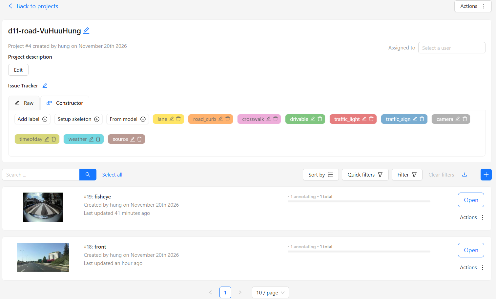
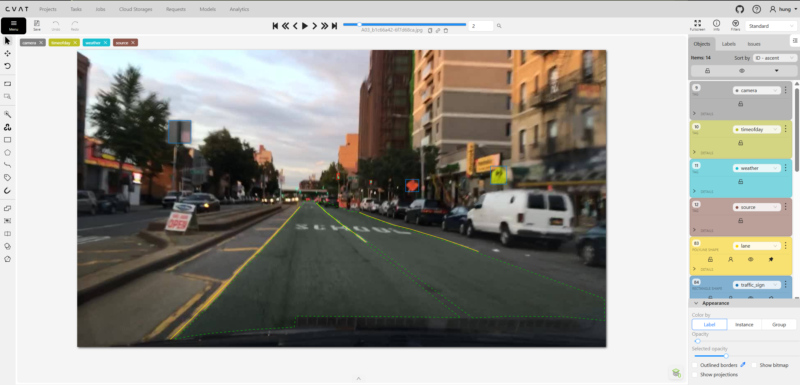
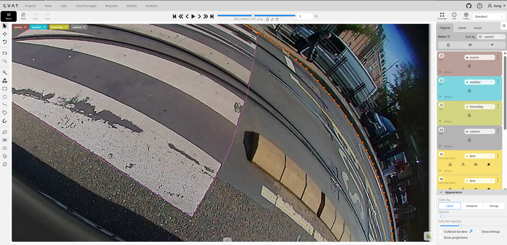
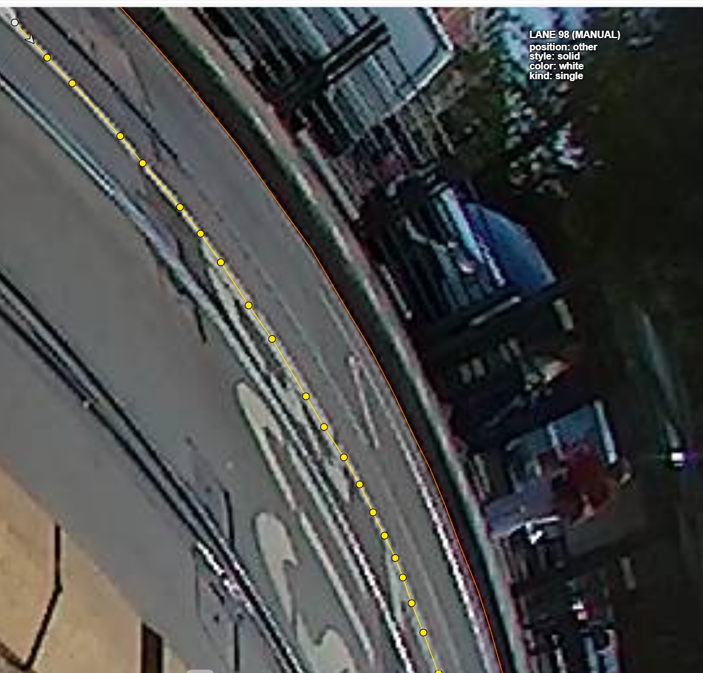

# Báo cáo cá nhân — Ngày 11
Họ tên: Vũ Hữu Hưng              Mã học viên:  2A202603306
Phiên bản CVAT (Help → About):  2.74.1
Guideline: Road v1.0    Lần nộp (`revision` trong manifest): 1 
Thời điểm export (ngày giờ trên CVAT): Nov 21st 26, 2:40   Số lần nộp lại sau Rework: 1 

## 1. Kiểm project
| Mục | Đúng như guideline Road v1.0? | Ghi chú |
| --- | --- | --- |
| 6 label, đúng kiểu | đúng | đủ |
| Thuộc tính và giá trị | đúng | điền đúng các thuộc tính |
| 4 tag ảnh | đúng | 4 tag điền đúng giá trị |
Cách kết thúc polyline trên bản CVAT này: n 
Cách đặt tag ảnh trên bản CVAT này: tag, chỉnh thuộc tính 

## 2. Số lượng đã gán
| Task | Ảnh | lane | road_curb | crosswalk | drivable | traffic_light | traffic_sign |
| --- | ---: | ---: | ---: | ---: | ---: | ---: | ---: |
| front | 12 | 28 | 14 | 7 | 27 | 25 | 29 |
| front-extra (đã làm 4 / 4) | 4 | 12 | 6 | 4 | 9 | 10 | 14 |
| fisheye | 8 | 11 | 16 | 12 | 7 | 5 | 12 |
| fisheye-extra (đã làm 4 / 4) | 4 | 0 | 4 | 3 | 1 | 0 | 2 |

## 3. Bảng ca khó
| Ảnh | Nhãn | Phân vân giữa | Đã chọn | Lý do |
| --- | --- | --- | --- | --- |
| A05, A06, A07, A10 | `lane` (`L1`/`R1`) | Tự ước lượng vẽ thêm vạch hay bỏ qua | Không gán vạch không thấy (A05: `L1`/`R1`; A06, A10: `R1`; A07: `L1`) | Vị trí đó không có vạch sơn kẻ làn hoặc mép đường là vỉa hè (`road_curb`); theo guideline không vẽ thêm khi thật sự không thấy vạch |
| A03, A08, A10, A15 | `traffic_sign` (`group`) | Xếp vào 5 nhóm chức năng chính hay `other` | `group = other` | Biển ở góc nghiêng/mờ hoặc biển đặc thù không xác định chắc chắn chức năng theo bảng quy đổi biển Mỹ |
| A06, A08, A10, A11, A12, B02 | `traffic_light` (`color`) | `off` hay `unknown` | `color = unknown` | Đèn quay mặt ngang/mặt sau (`facing = side/back`) hoặc bị lóa/mờ nên không xác định được màu đang sáng |
| B02, B03, B05, B08, B10, B11 | `traffic_light` / `traffic_sign` (`edge_zone`) | Bật hay tắt `edge_zone` gần rìa 80% bán kính | Bật `edge_zone` cho box sát viền ảnh bị méo mạnh, tắt với box trong vùng trung tâm (B11) | Áp dụng quy tắc 80% bán kính vòng ảnh cho camera fisheye (riêng B02 `#4` và B03 `#7` nằm sát ranh giới 80%) |
| B06 | `lane` (`position`) | `L1`/`R1` theo góc nhìn hay `other` | `position = other` | Ảnh từ camera hai bên (`fisheye_left`), theo mục 4 guideline mọi `lane` ở camera hai bên bắt buộc đặt `position = other` |

## 4. Phiếu QC 1 nhận được
Bạn kiểm lô của tôi:  Quyết định nhận được:  
| Mã lỗi | Số lỗi | Đồng ý? | Đã sửa? |
| --- | ---: | --- | --- |
| QC1-05 | 1 | có | có |
| QC1-10 | 1 | có | có |

## 5. Kiểm file export
| File | Mở lại được? | Số shape ảnh 1 (job / file) | Số shape ảnh 2 (job / file) | Tag camera có trong XML? |
| --- | --- | --- | --- | --- |
| `VuHuuHung-front.zip` | Có (`road_check lint` OK, `contains_images = false`) | 10 / 10 (`A01`) | 8 / 8 (`A02`) | Có (16/16 ảnh đều có `camera = front`) |
| `VuHuuHung-fisheye.zip` | Có (`road_check lint` OK, `contains_images = false`) | 5 / 5 (`B01`) | 12 / 12 (`B02`) | Có (12/12 ảnh có `camera` đúng theo `FV/RV/MVL/MVR`) |

## 6. Ảnh chụp màn hình
1. Tab Labels của project. 
2. Một ảnh camera trước đã gán đủ (làn, vùng lái, đèn/biển). 
3. Một ảnh fisheye đã gán, phóng to đoạn polyline cong. 
4. Một đoạn XML có <polyline label="lane">. 

## 7. Tự đánh giá
Lỗi mắc nhiều nhất hôm nay (theo mã QC1-xx), và cách tránh ở Ngày 20: Lỗi mắc nhiều nhất là **QC1-11** (quên bật/tắt `edge_zone` cho đèn, biển gần viền 80% bán kính trên ảnh fisheye) và **QC1-02 / QC1-03** (sót vạch `L1`/`R1` ở vài ảnh front và quên đổi `position = other` cho `lane` ở camera hai bên B06 do CVAT tự điền mặc định `L1`). Cách tránh ở Ngày 20: kiểm tra và sửa thuộc tính trong bảng Details ngay sau khi vẽ xong từng hình; với ảnh fisheye luôn đối chiếu quy tắc `position = other` (camera trái/phải) và `edge_zone` trước khi chuyển ảnh, đồng thời chạy `road_check lint` để tự rà soát trước khi nộp.
Nhãn của bạn đi vào model ở đâu? Chọn một lỗi đã sửa và nói nó làm model học sai thế nào: Nhãn `lane` (polyline), `drivable` (polygon), `traffic_light`/`traffic_sign` (box + thuộc tính) và 4 tag ODD là Ground Truth để huấn luyện và đánh giá các model nhận diện phần tử đường (lane detection cho LKA, phân vùng mặt đường đi được, phát hiện đèn/biển báo) cũng như phân tầng dữ liệu theo điều kiện môi trường. Ví dụ lỗi đã sửa là **QC1-03 ở ảnh B06** (camera bên trái `fisheye_left` nhưng `lane` ban đầu để mặc định `position = L1` thay vì `other`): nếu không sửa, model giữ làn (LKA) sẽ học nhầm vạch đường nhìn ngang từ camera hông thành vạch giới hạn làn bên trái (`L1`) của xe, làm sai lệch ước lượng vị trí làn và dễ gây cảnh báo hoặc đánh lái sai.

## 8. (Tùy chọn, buffer) Từ polyline đến đích row-anchor
| y | 720 | 680 | 640 | 600 | 560 |
| --- | ---: | ---: | ---: | ---: | ---: |
| x của chúng tôi |  |  |  |  |  |
| x của bạn kia |  |  |  |  |  |

Trả lời 3 câu:

1. Năm số x đó chính là đích mà một model row-anchor học cho vạch này. Nếu bạn dừng polyline sớm 40 px, hàng nào đổi thành "không có làn"?
2. So với bạn được kiểm (cùng ảnh): ở hàng 720 và hàng 560, hai bạn lệch nhau bao nhiêu pixel? Lệch ở hàng nào ảnh hưởng LKA nhiều hơn (slide 25)?
3. Nếu polyline vẽ từ xa về gần (ngược quy tắc 2), cách tính trên có đổi không? Script nào sẽ gặp khó?

link drive 3 file đầu: https://drive.google.com/drive/folders/1dKEa5_58nCS8wk1KyH4-uNRM27_NBkWr?hl=vi